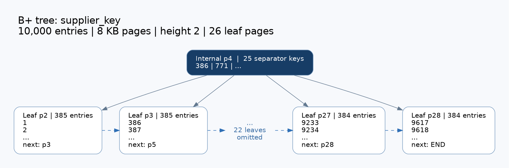
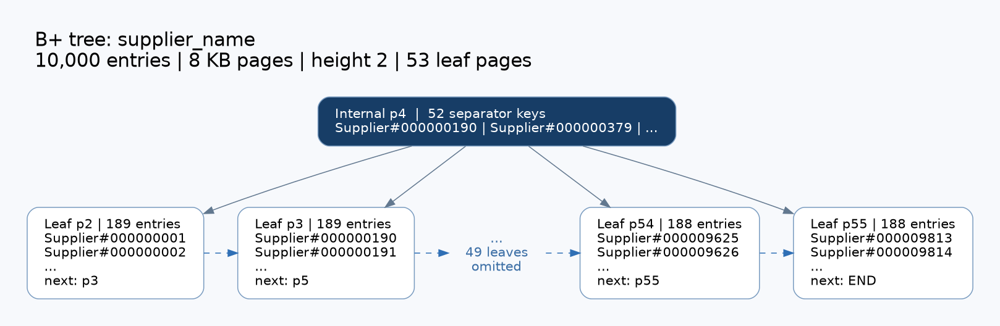

# 给实验二报告编写者的交接说明

实现已完成，可直接使用本页复现、截图和组织报告。详细设计见 [experiment2-index.md](experiment2-index.md)。这份交接说明与代码一同提交，报告作者无需依赖聊天记录。

## 先运行这三步

在仓库根目录执行，确保 `test/tpc-h/supplier.tbl` 是有效的真实数据文件。

```sh
# 1. 生成可执行文件并跑全部自动测试
cmake -S . -B build -DCMAKE_BUILD_TYPE=Release
cmake --build build -j 6
ctest --test-dir build --output-on-failure

# 2. 现场演示：创建表、加载数据、建两类索引、展示树、查找、插入、更新、删除
./build/minidb_shell --db /tmp/exp2_live_demo --buffer 16 --file scripts/demo_index.txt

# 3. 自动验收：20,000 次逐条查找、范围与全表扫描对照、维护与重开
./build/minidb_verify_index_tpch test/tpc-h/supplier.tbl /tmp/exp2_acceptance
```

两条演示命令应选择不同的新目录。重复验收时换一个目录名；验收程序不会覆盖已有目录。macOS 本机若找不到 cmake，可将 `/Users/lostgreen/Library/Python/3.9/lib/python/site-packages/cmake/data/bin` 加到 PATH；其他机器按自己的 CMake 安装位置处理。

验收程序最终返回 0，打印 `range_vs_heap=OK`、`insert_update_delete=OK`、`final_reopen=OK`。完整数据留在本地，不加入 Git。跨机器提交时用源码重新编译，`build/minidb_shell` 是本机生成的 macOS arm64 可执行文件。

## 可直接写入报告的实测结果

测试日期：2026-11-11。环境：Linux x86_64（Ubuntu 24.04，内核 7.0）、GCC 12.4.0、C++20、CMake Release。当前版本只在 Linux 上实测；批量建树等改动之前的版本曾在 macOS 27.0 arm64、Apple Clang 17.0.0 上测试通过。测试数据：现有真实 TPC-H `supplier.tbl`，共 10,000 行。页大小 8 KB，验收缓冲池为 16 帧（128 KB）。

| 项目 | supplier_key | supplier_name |
| --- | ---: | ---: |
| 索引列 | s_suppkey | s_name |
| 数据类型 | INTEGER | CHAR(25) |
| 索引项数 | 10,000 | 10,000 |
| 树高（根为第 1 层） | 2 | 2 |
| 节点总数 | 27 | 54 |
| 叶节点数 | 26 | 53 |
| 每节点最大键数 | 450 | 218 |
| 初始空闲页数 | 0 | 0 |
| 结构校验 | ok | ok |

两棵索引合计建树耗时本次为 **0.0123916 秒**（批量建树，节点预留 1/8 空间，所以节点数少于逐条插入时的半满树），不含数据 COPY；这是单次本机结果，报告中应明确测量范围，其他机器复现时填写自己的实测值。字符键较宽，因此每页容纳的键更少，叶节点数更多。

更大规模的实测（同一环境，TPC-H `orders.tbl` **1,500,000 行**，默认 1024 帧即 8 MB 缓冲池；三个索引分别建在 `o_orderkey`、`o_custkey`（INTEGER）和 `o_clerk`（CHAR(15)）上）：

| 项目 | 结果 |
| --- | --- |
| COPY 导入（无索引） | 3.8 s |
| CREATE INDEX（每个索引，批量建树，内存内排序） | 0.6–1.5 s，树高 3，3,819 / 3,819 / 5,727 个节点 |
| 点查 `o_orderkey = ...`：无索引 → 有索引 | 0.367 s → 小于 0.001 s |
| 按键 UPDATE / DELETE 单行（走索引定位） | 0.001 s 以内 |
| 范围 DELETE 约 10 万行（同时维护三个索引） | 3.6 s |
| 先建三个索引再 COPY 150 万行（逐条维护） | 66 s，主要是小缓冲池下随机键造成的换页 I/O |
| 增删改后三个索引 `index_check` | 全部 ok |

外部归并建树的实测（TPC-H `lineitem.tbl` **6,001,215 行**，COPY 导入 13 s；进程内存峰值含 8 MB 缓冲池）：

| 索引列 | 排序内存预算 | 有序段数 | 建树耗时 | 进程内存峰值 |
| --- | --- | ---: | ---: | ---: |
| `l_orderkey` INTEGER | 64 MB（默认） | 2 | 3.6 s | 74 MB |
| `l_shipinstruct` CHAR(25) | 64 MB（默认） | 3 | 5.9 s | 71 MB |
| `l_shipinstruct` CHAR(25) | 8 MB | 20 | 5.4 s | 18 MB |
| `l_orderkey` INTEGER | 64 KB | 1,710（4 趟归并） | 4.6 s | 12 MB |

两棵树高度均为 3（15,272 和 31,585 个节点），`index_check` 通过，之后的索引查找和删除维护正常。作为对照，不设内存上限、全部在内存排序的早期版本在同样数据上峰值为 600–794 MB。`scripts/demo_index.txt` 末尾用 64 KB 预算在 supplier 上演示了落盘归并（消息显示 `external sort: 3 runs merged in 1 pass`）。不建索引时进程本身约 9 MB。

重开后按两种键分别核对所有源记录，共 **20,000 次点查找**，全部一致。范围查询与全表扫描结果一致。插入、修改键、修改名称、删除及再次重开全部通过。验收程序第二次打开数据库后累计缓冲统计为 `miss=1022, evict=1020, flush=36`；这些计数覆盖该会话的查找、重建及 DML，不是单条查询的 I/O 次数。

最终 Release CTest：**3/3 通过**，包括原有 integration/storage 和新增 index 测试，总用时 **4.86 秒**。时间随缓存和机器负载变化。新增测试还覆盖跨 extent 扩容、重复值、交错增删、根收缩、空闲页复用、2–4 帧换页、BIGINT 边界、含 NUL 的字符串、错误输入、heap 转发和校验和损坏。

可核对的结果文件：

- [TPC-H 实测摘要](exp2-evidence/tpch-results.txt)
- [最终 CTest 结果](exp2-evidence/ctest-results.txt)

## 可直接用于 Word / PDF 的图

下面两张 PNG 来自本次真实树的页号、键样例和节点数量；为适应报告版面，仅展示前两页与后两页，中间叶节点明确标注为省略。它们是结构示意图，不是终端截图，由 `scripts/index_figure.py <name>.tree <name>.png` 从树图文件生成（需要 Graphviz）。完整结构保存在对应 `.tree`、`.dot` 文件中。



建议图注：**图 X：supplier 整数索引的 B+ 树结构。内部根节点保存分隔键，叶节点保存键与 RID 并按顺序连接；图中省略中间 22 个叶节点。**



建议图注：**图 Y：supplier 字符索引的 B+ 树结构。CHAR(25) 键使节点容量下降至 218，10,000 条索引项占用 53 个叶节点；图中省略中间 49 个叶节点。**

完整材料：[整数树](exp2-evidence/supplier_key.tree)、[字符树](exp2-evidence/supplier_name.tree)、[整数 DOT](exp2-evidence/supplier_key.dot)、[字符 DOT](exp2-evidence/supplier_name.dot)。需要矢量图时可用 Graphviz 的 `dot -Tsvg` 导出；页面过宽时使用上述截取结构图。

## 建议截图与验收顺序

| 顺序 | 操作 | 应观察到的结果 |
| --- | --- | --- |
| 1 | `PRAGMA indexes(supplier)` | 两类索引及各自 10,000 个条目 |
| 2 | `PRAGMA index_stats(supplier_key)` 与 `index_stats(supplier_name)` | valid=ok、树高、节点数和容量 |
| 3 | `PRAGMA index_tree(supplier_key)` | 根、子页、分支线、叶后继箭头 |
| 4 | 按编号 42 和名称 Supplier#000000042 查询 | 返回相同记录，并显示 INDEX SCAN |
| 5 | 编号 >= 9995，LIMIT 6 | 通过索引范围扫描输出 6 行 |
| 6 | demo 脚本插入编号 -1，再改成 -2 / IndexChanged | 原键查询为空、新键/名称可查 |
| 7 | 删除 -2，再按 IndexChanged 查询 | 空结果，两个索引检查仍为 ok |
| 8 | 关闭 shell 后重开同一数据库 | 索引列表仍存在，编号 42 可查 |
| 9 | 自动验收程序 | 20,000 点查找、范围对照、DML、重开通过 |

小缓冲池会产生实际页换入换出，可用 `PRAGMA buffer_stats`、`PRAGMA buffer_frames` 观察。演示脚本含 `.echo on`，截图会包含执行的 SQL，便于对应实验步骤。

## 核心源码阅读导航

| 文件 / 函数 | 报告应解释的内容 |
| --- | --- |
| `src/index/bplus_tree.h` / BPlusTree | 模块 API、键与 RID、元数据、统计结构 |
| `src/index/bplus_tree.cpp` / Read、Write、SaveMetadata、Allocate、Free | 页布局、外存读写、文件扩容、空闲页复用 |
| InsertNode、Insert | 二分定位、叶分裂、内部节点分裂、创建新根 |
| EraseNode、Rebalance、Erase | 借位、合并、父分隔键调整、根收缩 |
| FindLeaf、Scan、Find | 等值/范围查找、跨页重复键、LIMIT 提前结束 |
| Validate、Draw、Dot | 结构不变量校验、命令行图、DOT 图源 |
| `src/db/index.cpp` | SQL 建/删索引、重开发现、索引维护与 introspection |
| `src/db/database.cpp` / ExecuteSelect | 按列选择索引、RID 回表；插入/更新/删除/COPY 的维护调用 |
| `src/record/value.cpp` / CompareValues | BIGINT 精确比较、与 SQL 一致的字符串比较 |
| `tests/test_index.cpp` | 随机参考模型、边界、持久化及 SQL 回归测试 |
| `tests/verify_index_tpch.cpp` | 真实数据验收流程及结果生成 |

## 报告章节安排

1. **分工安排**：填写实际成员姓名、负责内容、交接方式；这里没有代填或推断任何人的贡献。
2. **实验环境**：引用本页实测环境，若重新测试则替换为实际环境。
3. **设计与实现**：说明页格式、索引元数据、 `(key, RID)`、两种类型、分裂/借位/合并/根收缩、叶链、缓冲池与磁盘交换；详见设计文档。
4. **使用手册**：放构建命令、CREATE/DROP INDEX、SELECT、PRAGMA、demo 脚本和重开步骤。
5. **测试方案与结果**：先列功能与边界测试，再列真实数据规模与量化结果，附结果表、树图和终端截图。
6. **实验总结**：围绕外存 B+ 树、稳定 RID 与存储层复用总结实现经验；说明后续可扩展为复合/唯一索引和事务恢复。

课程 PDF 要求的最终报告是 **Word 和 PDF 两种格式**。本交接页与设计页是写作素材，报告编写者还需补齐真实分工、正文、截图及排版，导出两种格式；可执行文件、源码和工程配置也应按课程要求准备。

## 写作时保留的实现边界

当前支持单列、非唯一索引；不支持联合/唯一索引、FLOAT/DECIMAL/DATE 索引、并发写树和崩溃恢复。NULL 不入索引；字符声明长度最多 4000 字节。SELECT、UPDATE、DELETE 的 WHERE 列有索引时都用索引定位行（`!=` 除外），语句消息显示 `INDEX SCAN name`。`CREATE INDEX` 用外部归并排序批量建树：排序内存有上限（默认 64 MB，`PRAGMA index_sort_memory = <KB>` 可调，只对当前会话有效，不持久化），超出时把已排序的一批写成临时文件里的有序段，再多路归并；有序段多于预算能负担的读缓冲数时先做多趟归并。建树内存由预算决定，与表的大小无关。正常关闭/重开有完整验证，不能写成已经实现 WAL 或完整事务原子性。树图为可读性截取展示，结构校验检查的是完整树。
