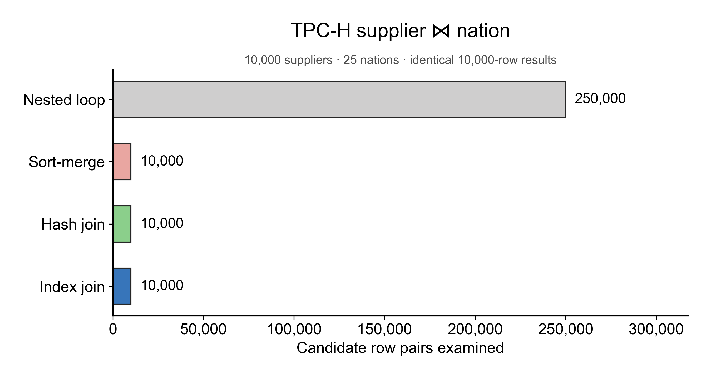

# 实验三报告编写与验收交接

实验三代码基于 2026-11-25 的上游 `4e7631c` 完成。详细数据结构、算法、SQL 和限制见 [设计与使用说明](experiment3-spj.md)。本页给报告作者提供复现步骤、结果、配图、截图与源码导航；无需依赖聊天记录。

## 三步复现

在仓库根目录执行：

```sh
cmake -S . -B build -DCMAKE_BUILD_TYPE=Release
cmake --build build -j 6
ctest --test-dir build --output-on-failure

./build/minidb_verify_spj_tpch test/tpc-h /tmp/spj_acceptance 50000
./build/minidb_shell --db /tmp/spj_acceptance --buffer 32 --file scripts/demo_spj.txt
```

验收数据库目录必须是新路径；重复自动验收时改名。`demo_spj.txt` 可在生成的数据库里重复运行。需要无外部数据的快速展示时，另选新数据库运行 `scripts/demo_spj_small.sql`，其数据明确为教学样例。

本机 CMake 安装目录是 `/Users/lostgreen/Library/Python/3.9/lib/python/site-packages/cmake/data/bin`，若命令找不到，将其加入 PATH。最终可执行文件为 `build/minidb_shell`、`build/minidb_spj_tests`、`build/minidb_verify_spj_tpch`；本机产物是 macOS arm64，Linux 等平台应重新编译。

## 本次测试环境与数据

日期：2026-11-25。macOS arm64，Apple Clang 17.0.0，C++20，Release。数据库页大小 8 KB；真实数据验收使用 32 帧缓冲（256 KiB），与查询算子的 64 MiB 逻辑预算分别管理。

| 来源表 | 使用行数 | 范围 |
| --- | ---: | --- |
| supplier | 10,000 | 本地真实 `.tbl` 全量 |
| nation | 25 | 本地真实 `.tbl` 全量 |
| region | 5 | 本地真实 `.tbl` 全量 |
| orders | 50,000 | 本地真实 `.tbl` 的前 50,000 行 |
| 合计 | 60,030 | 四张表 |

不能把本次 orders 规模写成 150 万行全量；保留的 `orders-prefix.tbl` 可以核对抽取范围。每个验收结果与直接读取源 `.tbl` 得到的参考值比较，保留重复记录且忽略无 ORDER BY 时的输出顺序。

## 结果表

最终 Release CTest **4/4 通过**：原 integration、storage、index，加新增 spj；本次共 **7.03 秒**。真实数据 **32/32 项核对通过**，包括关闭重开后的两类扫描、三类型选择、四种连接算法、复合条件、三表、非等值和卡氏积。

额外 ASan/UBSan 联合构建成功，但本机运行环境中连只含 `return 0` 的 ASan 空程序都在启动阶段超时；已停止该检查，不能写成 sanitizer 已通过。标准 Release 的正确性测试和演示已完成。

**supplier 与 nation 等值连接**：四种算法都返回 10,000 行。

| 算法 | 候选记录对 | 探测次数 | 本次用时（ms） |
| --- | ---: | ---: | ---: |
| NestedLoop | 250,000 | 0 | 19.0285 |
| SortMerge | 10,000 | 0 | 12.9615 |
| HashJoin | 10,000 | 10,000 | 10.6809 |
| IndexJoin | 10,000 | 10,000 | 15.5590 |

**supplier、nation、region 三表连接**：四种算法都返回 10,000 行。

| 算法 | 两级累计候选记录对 | 本次用时（ms） |
| --- | ---: | ---: |
| NestedLoop | 300,000 | 21.3506 |
| SortMerge | 20,000 | 16.3940 |
| HashJoin | 20,000 | 13.4907 |
| IndexJoin | 20,000 | 26.5467 |

用时为单次顺序执行测量，包含执行、投影与结果核对，不是隔离的算子 CPU 时间，也没有控制冷热缓存，不能据此声称一种算法在所有负载上最快。候选数反映这次查询具体执行了多少记录对检查，不能当作页 I/O。完整实测摘要见 [tpch-results.txt](exp3-evidence/tpch-results.txt)，包括所有选择和连接结果。

对比中也有值得解释的现象：orders 的优先级只有少量不同取值。强制按该列做 IndexJoin 时，需要大量回表后检查另一侧的订单编号条件，本次检查 549,184 个候选对才得到 651 行；Hash/SortMerge 在预过滤后的输入上只需处理 651 对。报告可以用它说明索引存在不等于索引连接一定高效，以及选择下推和成本优化的意义。

## 报告配图



建议图注：**四种连接算法在 supplier 与 nation 等值连接中的候选记录对数。四种算法均产生相同的 10,000 行结果；嵌套循环检查全部 250,000 对，其他三种算法通过有序键、散列桶或 B+ 索引缩小候选范围。**

PNG 为 300 DPI，可直接放入 Word；另有 [PDF](exp3-evidence/join-candidates.pdf) 与 [SVG](exp3-evidence/join-candidates.svg) 矢量版本。配图从实测文本生成，复现命令：

```sh
python3 scripts/spj_figure.py doc/exp3-evidence/tpch-results.txt doc/exp3-evidence/join-candidates
```

绘图只依赖 matplotlib，数据库本身不新增 Python 依赖。图表示算法候选数，不是耗时柱状图。

## 推荐截图与现场演示顺序

| 顺序 | 操作 | 要展示什么 |
| --- | --- | --- |
| 1 | CTest 和真实验收输出摘要 | 4/4 与 32/32 通过，数据规模 |
| 2 | `PRAGMA scan_method=table/index` 后执行相同条件 | TableScan 与 IndexScan，结果相同 |
| 3 | 编号范围、优先级不等、日期范围 | 三种数据类型的选择 |
| 4 | `id <= ... AND priority != ...` | 两类型共同选择 |
| 5 | 三列投影、`SELECT *`、`alias.*` | 投影接口和结果列 |
| 6 | 设置 nested_loop / sort_merge / hash / index | 同一等值连接的四种算法与统计 |
| 7 | 姓名/日期连接、编号和名称共同连接 | 三类型及两类型复合条件 |
| 8 | 非等值与 CROSS JOIN | NestedLoop/IndexJoin 对要求的覆盖 |
| 9 | supplier JOIN nation JOIN region | 三表左深连接；EXPLAIN 显示路径 |
| 10 | `PRAGMA index_check(o_date)` | 第三种类型复用外存 B+ 树，重开后的结构有效 |

`demo_spj.txt` 已包含这些 SQL 并开启 `.echo on` / `.timer on`。示例带 LIMIT 保持屏幕输出可读；自动验收核对完整查询结果，不只检查前几行。

## 核心源码导航与答辩要点

| 文件 | 关注内容 |
| --- | --- |
| `src/sql/parser.h/.cpp` | TableRef、SelectOperand、SelectPredicate；限定列、别名、AND/BETWEEN、JOIN、EXPLAIN |
| `src/db/select.cpp` | 名称/类型绑定、条件归属、扫描路径、IndexJoin、三表调度、投影、LIMIT、逻辑内存预算 |
| `src/execution/spj.h/.cpp` | Row/Rows、复合键、NestedLoop、SortMerge、HashJoin、重复组乘积与散列碰撞校验 |
| `src/index/bplus_tree.cpp` | DATE 元数据支持、整数天数编码、重开、日期键显示 |
| `src/db/pragma.cpp` | 算法选择、扫描方式、预算会话设置 |
| `tests/test_spj.cpp` | 独立参考模型，反向谓词、NULL/重复/边界/三表/错误处理 |
| `tests/verify_spj_tpch.cpp` | 读取真实输入、构造参考结果、完整结果比较、统计输出 |

可以重点回答：排序连接为何要处理重复键组的乘积；HashJoin 为何还要精确比较；索引连接中 `a.x < b.x` 如何转换内表边界；NULL 为何不参加普通比较但必须保留在卡氏积；三表条件为什么不能过早检查；LIMIT 为什么不能直接截断第一阶段中间结果；B+ 树与选择/连接如何共享同一存储接口。

## 报告组织与提交

推荐按课程要求组织为：真实分工、实验环境、设计与实现、使用手册、测试方案与结果、实验总结。成员姓名和贡献必须由小组填写。测试章节可使用本页结果表和配图，并补充现场终端截图。算法章节的接口和流程图素材在设计说明中。

当前交付的是源码、构建配置、可执行构建产物、验收脚本与报告写作素材。报告作者需完成排版并导出课程要求的 **Word 和 PDF**，不能把这份 Markdown 当作已完成的正式报告。提交前同时准备对应目标平台的可执行文件。

实现边界应准确描述：内连接、AND 合取、内存排序/散列、按 FROM 顺序的左深树；没有外部 SPJ spill、连接重排、OR、外连接、聚合、排序输出或完整 SQL 优化器。实验二的 B+ 树仍是外存索引，其外部排序批量建索引功能保持不变。没有声称 Linux 已实测，也没有声称 sanitizer 运行已通过。
