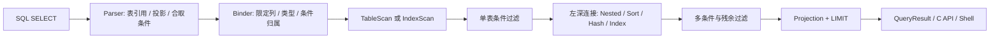

# 实验三：选择、投影与连接（SPJ）

基于上游 `4e7631c`（2026-11-25 同步）实现，保留实验一存储层及实验二后续的外部排序建索引、原位节点操作、索引更新/删除优化。SQL 查询复用同一套 Catalog、TableHeap、BufferPool 和 BPlusTree。

## 要求与实现对应

| 实验要求 | 实现 |
| --- | --- |
| TableScan / IndexScan | 顺序 heap 扫描；B+ 树条件扫描并按 RID 回表；可显式切换 |
| 三种类型的等值、非等值、范围选择 | INTEGER/BIGINT、CHAR/VARCHAR、DATE；六种比较运算，`!=` 和 `<>` 同义 |
| 两种类型的共同选择 | `AND` 合取；支持括号分组、`BETWEEN ... AND ...` |
| 三列不同类型投影及 `SELECT *` | 任意列列表、`*`、`alias.*`、原有 `rid` 伪列；保留重复记录 |
| 嵌套循环连接 | 等值、非等值、卡氏积，统一残余条件过滤 |
| 基于排序的等值连接 | 按单列/复合等值键排序、双指针归并；相等组输出完整重复组合 |
| 基于散列的等值连接 | 右侧建桶、左侧探测；复合等值键，散列碰撞后重新比较 |
| 基于索引的连接 | 按外表值探测右侧 B+ 树；等值、非等值；卡氏积遍历全索引并补充 NULL |
| 三种类型单条件连接、两类型多条件连接 | 同一绑定和比较语义用于四种算法；整数、字符串、日期都有独立参考模型测试 |
| 三表连接 | 按 FROM 顺序构造左深连接树；各条件在引用的表齐备后立即检查 |
| 接口、源码与算法体现 | `EXPLAIN SELECT`、执行消息；`src/query/select_binder.*`（绑定与计划）、`src/execution/*_state.*`（火山算子）和 `src/execution/executor.*` |

## 构建与快速验收

```sh
cmake -S . -B build -DCMAKE_BUILD_TYPE=Release
cmake --build build -j 6
ctest --test-dir build --output-on-failure

# 不依赖 TPC-H 文件的教学数据演示：使用尚不存在的新数据库目录。
./build/minidb_shell --db /tmp/spj_small_demo --file scripts/demo_spj_small.sql

# 真实数据验收：supplier/nation/region 全量，orders 前 50,000 行。
./build/minidb_verify_spj_tpch test/tpc-h /tmp/spj_acceptance 50000

# 在上一步生成的数据库里演示。可重复执行这个只读查询脚本。
./build/minidb_shell --db /tmp/spj_acceptance --buffer 32 --file scripts/demo_spj.txt
```

验收程序只接受新数据库目录，不覆盖已有文件。真实 `.tbl` 文件不入 Git；当前本机 `test/tpc-h` 的链接指向工作目录的 `benchmark_data`，其他机器应准备对应数据文件。`orders-prefix.tbl` 是真实 orders 文件的前 N 行，留在验收数据库内便于追溯；不是随机或合成数据。更大数据可调整第四个参数；结果集由 `QueryResult` 承接、不计入查询内存预算，预算主要限制哈希/排序构建侧。

macOS 本机 CMake 若不在 PATH：

```sh
export PATH="/Users/lostgreen/Library/Python/3.9/lib/python/site-packages/cmake/data/bin:$PATH"
```

## SQL 与设置

```sql
PRAGMA scan_method = table;       -- auto / table / index
PRAGMA join_algorithm = hash;     -- auto / nested_loop / sort_merge / hash / index
PRAGMA query_memory = 67108864;   -- 按字节，默认 64 MiB

SELECT o_orderkey, o_orderpriority, o_orderdate
FROM orders
WHERE o_orderkey BETWEEN 100 AND 1000 AND o_orderpriority != '1-URGENT';

SELECT s.s_suppkey, n.n_name, r.r_name
FROM supplier AS s
JOIN nation AS n ON s.s_nationkey = n.n_nationkey
JOIN region AS r ON n.n_regionkey = r.r_regionkey;

SELECT a.*, b.o_orderdate FROM orders a, orders b
WHERE a.o_orderdate = b.o_orderdate AND a.o_orderkey <= 100 AND b.o_orderkey <= 100;

EXPLAIN SELECT s.s_suppkey,n.n_name
FROM supplier s JOIN nation n ON s.s_nationkey=n.n_nationkey;
```

裸表名、`AS` 别名与省略 `AS` 的别名都可使用。列有歧义时要求限定名；重复表别名、缺失列、连接类型不兼容会报错。日期用 `'1998-01-01'` 或 `DATE '1998-01-01'`。支持 `INNER JOIN ... ON`、`CROSS JOIN`、逗号 FROM；ON 与 WHERE 的合取条件统一绑定。没有 ORDER BY 时结果顺序不保证，比较算法结果应按多重集合比对，不能逐行按顺序比对，也不能丢掉重复行。

`scan_method` 控制表输入的选择路径；索引连接的内表探测独立使用它指定的 B+ 索引。强制 IndexScan 时没有可用索引会明确报错；全索引扫描会通过 heap 扫描补充索引未存储的 NULL 行。自动选择沿用实验二规则：可用索引支持等值/范围，`!=` 默认 TableScan。多个条件中使用一个可用索引，其他条件作为残余过滤。

`join_algorithm=auto` 的规则为：存在右表连接列索引时选 IndexJoin，否则有等值条件时选 HashJoin，否则选 NestedLoop。它是固定启发式规则，不是基于统计信息的成本优化器。强制 SortMerge/Hash 要求每一级连接至少一个等值条件；允许额外的非等值残余条件。强制 IndexJoin 要求右表连接列有索引；纯卡氏积要求右表至少一个索引。

`EXPLAIN` 只绑定、生成计划，不读取数据页。复杂 SELECT、显式扫描设置及连接的执行消息显示算法、`rows`、`candidates`、`probes`。`candidates` 是连接算法检查的候选记录对数，`probes` 是散列/索引探测次数，都不是物理磁盘 I/O 次数。单表简单查询保持原有 C API 消息行为；需要看完整路径时使用 EXPLAIN。

## 模块结构与算法



### 选择与投影

`SelectOperand` 表示列或常量，`SelectPredicate` 表示左右操作数及比较运算，`TableRef` 保存表名与别名。Binder 把列绑定为扁平列序号，记录其所属表。单表条件在输入加载时过滤；多表条件按最晚引用表分配到连接阶段。`BETWEEN` 展开为 `>=` 与 `<=`，反向常量/列比较会翻转索引扫描方向。

TableScan 使用 `TableHeap::Scan`，解码 tuple 后比较。IndexScan 访问已有外存 B+ 树，再通过稳定 RID 回表并检查全部本地条件。为满足第三种数据类型，B+ 树接受 DATE 键，以整数天数保存在原有 64 位键槽中；无需新建一套索引结构。日期叶项显示时恢复为 DATE，建树、维护、关闭重开复用实验二机制。

投影保留指定列顺序和重复行；`*` 不包含额外 RID 伪列，显式 `rid` 可查询原记录地址。NULL 参与普通比较不匹配；`WHERE column = NULL` 仍沿用原引擎的报错规则，没有新增 IS NULL 语法。

### 四种连接

- **NestedLoop**：遍历左右输入的全部记录对，每对检查连接条件；自然覆盖卡氏积和非等值连接，候选对复杂度 `O(LR)`。
- **SortMerge**：对行序号按复合等值键排序；双指针寻找相等键段，对左右重复键组做完整乘积，再检查残余条件。复杂度约 `O(L log L + R log R + K)`，K 为匹配组中的候选对数。
- **HashJoin**：按右输入复合键建立散列桶，左输入逐行探测。字符串规范化使用引擎原有 PAD SPACE 规则；数值散列采用统一数值表示，BIGINT 可能发生散列碰撞，但每次匹配会进行精确值比较，不会产生错误连接。平均复杂度 `O(L + R + K)`。
- **IndexJoin**：对外输入逐行探测右表 B+ 树，以等值或范围条件得到候选 RID，回表后检查右表本地条件及所有连接条件。若写为 `left < right`，扫描使用 `right > left`。复合等值条件使用其中一个有索引的列探测，其余条件过滤。纯卡氏积访问右表全索引，并单独处理其 NULL 键记录，防止遗漏。

三表按照 `(A join B) join C` 执行，表顺序决定算法中的左右输入。执行采用火山模型（`Begin/Next/ReScan/End`）：扫描算子只定位满足本地谓词的 RID，仅在需要过滤或连接键时解码相应列；连接算子只物化连接键和本级残余条件列，输出 tuple 由物理位置（RID）与少量已物化列组成；投影算子最后按 RID 回表解析结果列。某一列在最后一次被引用的连接级完成后立即从中间 tuple 中移除，因此已用过的连接键不会继续传给下一级。最后一级连接达到 LIMIT 后停止生成结果；不会错误地把 LIMIT 下推到前一级而漏掉后续匹配。

### 内存与范围

连接排序/散列及中间结果目前在内存中物化。默认 64 MiB **逻辑预算**按行字段、字符串和辅助结构估算；不是进程 RSS 的硬上限，STL 容量、分配器和缓冲池另有开销。扫描与中间 tuple 只物化连接键和残余条件列，投影按 RID 流式解析结果列；结果集由 `QueryResult` 承接、不计入查询预算，索引扫描只缓存匹配 RID（每项 8 B），散列/排序构建侧在输出耗尽后立即释放，因此默认预算可覆盖十万行量级的真实连接和几十万行的结果集。预算不足仍返回明确错误（主要出现在哈希/排序构建侧），用户可收紧条件或提高 `query_memory`（4 KiB 至 16 GiB）。当前未实现外部归并连接或 Grace Hash Join；实验二的索引批量构建仍使用已有外部归并排序。

支持的是内连接和合取 SPJ 子集；不含 OR、外连接、聚合、DISTINCT、ORDER BY、子查询、结果列重命名或成本优化。日期只与日期列连接，字符串家族互相兼容，INTEGER 与 BIGINT 兼容；其他类型要求同 TypeId。多条件解析仅扩展 SELECT，UPDATE/DELETE 继续使用原有单条件语法与索引定位。

## 测试入口

- `tests/test_spj.cpp`：固定种子数据与独立双/三重循环参考模型；六种比较、三种类型、反向操作数、两列等值键、NULL、重复键、字符填充、BIGINT 极值附近、三表、自连接、卡氏积、别名、投影、LIMIT、EXPLAIN 无读取、内存不足、日期索引维护和重开。
- `tests/verify_spj_tpch.cpp`：真实数据单独读取生成期望值；32 项查找/连接核对；保留重复行的完整结果比较；输出候选对和耗时。
- `scripts/demo_spj_small.sql`：合成教学数据，任何机器可直接运行。
- `scripts/demo_spj.txt`：真实验收数据库上的完整现场演示。

报告作者见 [experiment3-report-handoff.md](experiment3-report-handoff.md)。
